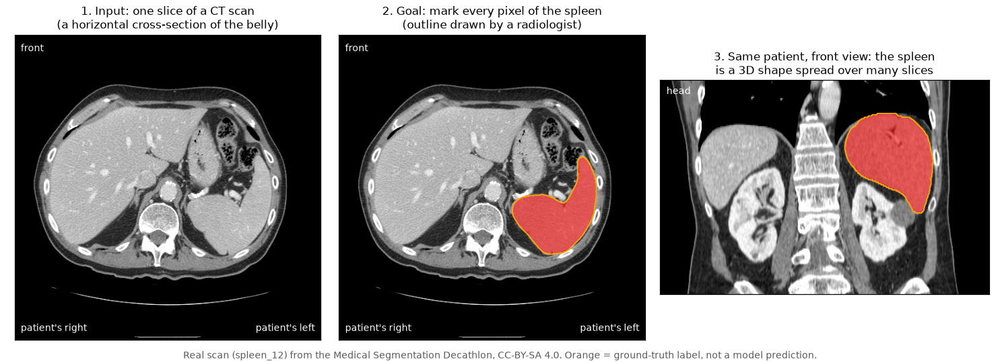

# Finding the spleen in 3D CT scans, fast

**SwinUNETR spleen segmentation → ONNX → TensorRT FP16, benchmarked on an NVIDIA T4**

[](https://github.com/kshitijv97/swinunetr-spleen-tensorrt/actions/workflows/tests.yml)
[](https://colab.research.google.com/github/kshitijv97/swinunetr-spleen-tensorrt/blob/main/notebooks/colab_train_and_benchmark.ipynb)
[](LICENSE)

> **New here? Start with the plain-English section below.** It assumes no
> background in medicine, engineering or AI. Technical readers can jump
> straight to [For technical readers](#for-technical-readers).

---

## What this project does, in plain English

A **CT scan** is a 3D X-ray picture of the inside of the body. It is a stack of
grey cross-sectional images, like slices of a loaf of bread. This project
teaches a computer to look at a CT scan of the belly and **colour in every
part of it that is the spleen** (a fist-sized organ under the left ribs). It
then makes that computer program run **much faster** on the kind of graphics
chip used in medical and robotic equipment, and measures carefully whether
the speed-up cost any accuracy.



*Above: a real scan from the public dataset used here. The orange area was
outlined by a radiologist. That is the "answer key" the computer learns from
(this is not the computer's own output). The computer has to produce outlines
like this by itself, on every slice, for scans it has never seen.*

### Why would anyone want this?

- **Surgical robots and image-guided surgery need a map.** Before and during
  an operation, software has to know where the organs are, especially
  delicate ones a surgeon must not cut. The spleen is one of them: it is
  full of blood, and accidental injury to it is a known risk in some
  abdominal operations.
- **Drawing outlines by hand is slow.** One scan has dozens to hundreds of
  slices. A computer that does it automatically saves expert time and makes
  3D organ models possible.
- **Speed matters.** A program that takes a long time per scan is fine for
  planning an operation the next day, but not for anything interactive. So
  making it fast is half of this project.

### What happens, step by step

| Step | What it means in everyday terms | Where it happens |
|---|---|---|
| **1. Get examples** | Download 41 real, anonymised CT scans in which experts have already outlined the spleen. They come from a public research dataset. | `src/data.py` |
| **2. Tidy them up** | Make every scan comparable: same orientation, same pixel size, same brightness range. This is like straightening and resizing photos before comparing them. | `src/data.py` |
| **3. Teach the computer** | Show the computer 33 of the scans over and over. Each time, it guesses the outline, compares it with the expert's, and nudges its internal settings to do better. This is called **training**. | `src/train.py` |
| **4. Test it fairly** | Check it on the other 8 scans, which it never learned from, like an exam with questions you have not seen before. | `src/train.py`, `src/evaluation.py` |
| **5. Make it portable** | Save the trained program in a standard format (**ONNX**) that other tools can read, and double-check the saved copy gives the same answers as the original. | `src/export_onnx.py` |
| **6. Make it fast** | Hand it to NVIDIA's optimiser (**TensorRT**), which rewrites it specifically for one graphics chip, removing wasted steps and doing arithmetic with fewer digits (**FP16**) where that is safe. | `src/trt_utils.py` |
| **7. Measure honestly** | Time the original and optimised versions on the same 8 test scans, and check the outlines are still just as accurate. | `src/benchmark.py` |

### How do we know if it works?

The project answers two questions, each with one number:

1. **How accurate are the outlines?** This is measured with the **Dice
   score**: how much the computer's outline overlaps the expert's. **1.0
   means a perfect match, 0 means no overlap at all.** Think of two
   overlapping stickers: the more they line up, the closer to 1.
2. **How fast is it?** This is measured as **latency**: how many seconds the
   computer needs to outline the spleen in one whole scan. Lower is better.
   The **speed-up** is how many times faster the optimised version is than
   the original.

The goal is for the optimised version to be clearly faster **with
essentially the same Dice score**. If it got faster but less accurate, the
results will say so.

> **Current status, plainly:** all the code is written, tested and checked
> on a laptop. The full training and speed measurements need a powerful
> NVIDIA graphics chip (free on Google Colab) and **have not been run yet**.
> That is why the results tables below say *TBD*. No number in this
> repository is guessed or made up.

### What this project is *not*

- **Not a medical device.** It has not been tested on patients and must not
  be used to make any medical decision.
- **Not proof it works everywhere.** It learns from only 41 scans from one
  hospital. Scans from other hospitals, machines or patients could behave
  differently.
- **Not a new AI model.** The model design (SwinUNETR) comes from published
  research and the open-source MONAI library. This project's work is the
  complete, tested pipeline around it: preparing the data, training,
  verified export, GPU optimisation and honest measurement.

### Jargon decoder

| You will see | It means |
|---|---|
| **CT scan** | A 3D X-ray image made of many thin cross-sectional slices. Brighter means denser tissue. |
| **Segmentation** | Labelling every pixel (here, every tiny 3D cube, or *voxel*) as "spleen" or "not spleen". |
| **SwinUNETR** | The type of AI model used. It looks at the scan in small 3D blocks and learns how the blocks relate to each other, then draws a detailed outline. |
| **Training** | Letting the model learn from examples with known answers. |
| **Validation scans** | Scans held back from training and used only to test it. |
| **Dice score** | The overlap score between computer and expert outlines, from 0 (none) to 1 (perfect). |
| **GPU** | A graphics chip. It is very good at the huge number of simple calculations AI needs. |
| **NVIDIA T4** | The specific GPU used for the measurements. Google Colab provides it for free. |
| **PyTorch / MONAI** | The open-source software used to build and train the model (MONAI is PyTorch for medical images). |
| **ONNX** | A standard file format for AI models, like PDF for documents. Many tools can open it. |
| **TensorRT** | NVIDIA software that rewrites a model to run as fast as possible on one specific NVIDIA GPU. |
| **FP32 / FP16** | Doing arithmetic with about 7 significant digits (FP32) or about 3 (FP16). FP16 is faster and usually just as good for AI. |
| **AMP** | "Automatic mixed precision": using FP16 where safe and FP32 where needed, inside PyTorch. |
| **Latency** | Time to process one scan. |
| **Smoke test** | A tiny, quick run that only checks that every step of the pipeline works, not that the results are good. |

### Where to go next

| If you are... | Read |
|---|---|
| Curious, with no technical background | [**The project explained for everyone**](docs/overview-for-everyone.md): a longer, friendly walk-through with an FAQ |
| An engineer new to medical imaging or AI | The [**learning track**](docs/learn/README.md): 13 chapters from first principles |
| Already an expert | The [**technical reference**](docs/reference/README.md), or keep reading below |
| Wanting to run it | [Reproduce](#reproduce) below, or the Colab button at the top |

---

## For technical readers

An end-to-end, reproducible pipeline for **3D spleen segmentation in
contrast-enhanced CT**: a SwinUNETR trained from scratch with MONAI on MSD
Task09, exported to ONNX with a numerical parity check, compiled to a
**TensorRT FP16** engine, and benchmarked against PyTorch FP32 and AMP on an
NVIDIA T4 for **per-volume latency and Dice**.

The scope is deliberately narrow: one cohort, one architecture, one deployment
path. The effort goes into a correct pipeline and a measurement protocol that
says exactly what each number means.

> **Status:** implementation, tests, CPU CI and the local smoke test are
> complete. The full T4 training and benchmark have **not been run yet**.
> Every result cell below reads *TBD* until they come from
> [the Colab notebook](notebooks/colab_train_and_benchmark.ipynb). Nothing here
> is estimated.

**Documentation comes in three tracks:**

| | For | Start at |
|---|---|---|
| **Technical reference** | Readers fluent in DL, medical imaging and GPU inference who want the design decisions, exact settings and caveats | [docs/reference/](docs/reference/README.md) |
| **Learning track** | Engineers new to the field: CT physics, signals, ML, transformers, training and GPU deployment, from first principles | [docs/learn/](docs/learn/README.md) |
| **For everyone** | Readers with no technical or medical background | [docs/overview-for-everyone.md](docs/overview-for-everyone.md) |

---

### Motivation

Pre-operative organ segmentation feeds surgical planning, registration and
navigation, and virtual-fixture constraints in robot-assisted surgery. The
spleen is a relevant at-risk organ: highly vascular, and a recognised site of
iatrogenic injury in left-upper-quadrant and colorectal procedures (for
example, splenic flexure mobilisation). Clinical use needs two things: an
accurate 3D shape, and inference fast enough on the target GPU for the
workflow it serves. Hence the second half of this project: TensorRT, which is
the same toolchain used on Jetson-class embedded GPUs.

### Method

| Stage | Choice | Details |
|---|---|---|
| Data | MSD Task09 Spleen, 41 labelled portal-venous CTs; fixed seeded split **33 train / 8 val** | [data.md](docs/reference/data.md) |
| Preprocessing | RAS reorientation; resample to 1.5 × 1.5 × 2.0 mm (trilinear / nearest); HU window [−57, 164] → [0, 1]; foreground crop | [data.md §3](docs/reference/data.md#3-deterministic-pipeline-train-and-validation) |
| Sampling / augmentation | 4 × 96³ crops per case, 1:1 spleen/background centres; flips, in-plane 90° rotations, intensity shift | [data.md §4](docs/reference/data.md#4-stochastic-pipeline-training-only) |
| Model | SwinUNETR, $F = 48$, depths (2,2,2,2), heads (3,6,12,24), window 7: **62.2 M params**, trained from scratch | [architecture.md](docs/reference/architecture.md) |
| Objective / optimiser | Dice + CE (MONAI `DiceCELoss`), AdamW 1e-4 / wd 1e-5, cosine to 0 over 150 epochs, FP16 AMP with dynamic loss scaling | [training.md](docs/reference/training.md) |
| Inference | Sliding window 96³, overlap 0.5, Gaussian blending ($\sigma = 0.125 \cdot 96$), batch 4, argmax, no post-processing | [inference-and-evaluation.md](docs/reference/inference-and-evaluation.md) |
| Metric | Foreground Dice per volume, mean over 8 validation cases, in resampled space | [inference-and-evaluation.md §3](docs/reference/inference-and-evaluation.md#3-dice-as-computed-here) |
| Export | ONNX opset 18, static $(4,1,96,96,96)$, verified against PyTorch with ONNX Runtime (`allclose`, atol = rtol = 1e-3) | [deployment.md §2](docs/reference/deployment.md#2-onnx-export) |
| Parity gate | Every backend vs PyTorch FP32 (TF32 off), one tolerance tier per precision (fp32 strict elementwise; fp16/bf16/int8 judged on class flips, confident flips and Dice drop); fixed-seed golden batches + optional whole volumes; non-zero exit on failure | [deployment.md §2.1](docs/reference/deployment.md#21-parity-gate) |
| Engine | TensorRT 10, FP16 builder flag, per-layer precision by the builder; zero-copy integration on PyTorch's CUDA stream | [deployment.md §3–4](docs/reference/deployment.md#3-tensorrt-engine-build) |
| Benchmark | Synchronised wall-clock latency of whole-volume sliding-window inference (GPU-resident input), 2 warm-up + 8 vols × 3 repeats; mean / p50 / p95; Dice per backend | [benchmarking.md](docs/reference/benchmarking.md) |

```
MSD Spleen ─▶ MONAI preprocessing ─▶ SwinUNETR training ─▶ best.pt ─┬─▶ PyTorch FP32 / AMP ──┐
                                                                    └─▶ ONNX (+ parity) ─▶ TensorRT FP16 ─┴─▶ latency + Dice
```

### Results

> ⚠️ **TBD: run notebook.** Values come from
> `notebooks/colab_train_and_benchmark.ipynb` on a Colab T4. The field-to-cell
> mapping is in [docs/author-notes/reporting-results.md](docs/author-notes/reporting-results.md).

#### Training

| | Value |
|---|---|
| Train / validation volumes | 33 / 8 |
| Model | SwinUNETR, $F = 48$, 62.2 M parameters |
| Epochs trained | TBD: run notebook |
| Training time (T4) | TBD: run notebook |
| Best validation Dice (AMP, during training) | TBD: run notebook |

<!-- After the Colab run, uncomment:  -->

#### Inference (NVIDIA T4, 8 validation volumes × 3 repeats)

Latency = whole-volume sliding-window inference (96³, batch 4, overlap 0.5),
input already on the GPU, after warm-up, CUDA-synchronised. Preprocessing,
I/O and post-processing are excluded.

| Backend | Mean latency / volume (ms) | p95 (ms) | Speed-up vs FP32 | Mean Dice |
|---|---:|---:|---:|---:|
| PyTorch FP32 | TBD: run notebook | TBD: run notebook | 1.00× | TBD: run notebook |
| PyTorch AMP (FP16 autocast) | TBD: run notebook | TBD: run notebook | TBD: run notebook | TBD: run notebook |
| TensorRT FP16 | TBD: run notebook | TBD: run notebook | TBD: run notebook | TBD: run notebook |

#### Export

| | Value |
|---|---|
| ONNX vs PyTorch max abs. logit difference | TBD: run notebook |
| ONNX vs PyTorch argmax agreement | TBD: run notebook |
| TensorRT engine build time / size | TBD: run notebook |
| Software (driver / CUDA / PyTorch / TensorRT) | TBD: run notebook |

### Limitations

- **Small, single-centre cohort.** 41 portal-venous CTs from one institution
  and one patient population (liver metastases under chemotherapy). No claim
  of external validity across scanners, phases or pathology.
- **Validation, not test.** One fixed 33/8 split. The checkpoint is selected
  on the same 8 cases it is reported on (optimistic bias). $n = 8$ gives wide
  uncertainty, and per-case Dice is in `benchmark.json`.
- **Resampled-space Dice, no surface metric.** Dice is computed on the
  1.5 × 1.5 × 2 mm cropped grid, not natively. No HD95/NSD is reported.
- **One GPU, model-only latency.** Shared, virtualised Colab T4 with that
  day's software stack. Preprocessing and I/O are excluded, and speed-ups
  will differ on other hardware and TensorRT versions.
- **Static engine shape.** $(4, 1, 96^3)$ only, which is sufficient for
  sliding-window inference but not a dynamic-shape deployment.
- **Not a medical device.** Research and education only. Not for clinical
  decisions.

### Reproduce

**Local (CPU/MPS, no NVIDIA GPU).** This is a pipeline check with a tiny
model ($F = 12$), 2 volumes, 64³ crops and 2 epochs. The outputs go to the
git-ignored `results/smoke/`.

```bash
python3.12 -m venv .venv && source .venv/bin/activate
pip install -r requirements.txt
pytest -q
python -m src.train --smoke-test --synthetic      # drop --synthetic to use 2 real volumes (1.5 GB download)
python -m src.export_onnx --smoke-test
python -m src.parity --smoke-test --synthetic --volumes 1   # TensorRT recorded as "skipped: needs CUDA"
python -m src.benchmark --smoke-test --synthetic  # AMP / TensorRT recorded as "skipped: needs CUDA"
```

**Full run (Colab T4).** Open the notebook with the badge above, select
*Runtime → Change runtime type → T4 GPU*, then *Run all*. It installs pinned
dependencies and TensorRT, tests, downloads, trains, exports, benchmarks and
packages `results.zip`. See [colab.md](docs/reference/colab.md). On any
CUDA Linux host:

```bash
pip install -r requirements-colab.txt    # plus a CUDA build of torch
python -m src.data --download && python -m src.train && python -m src.export_onnx && python -m src.parity --volumes 8 && python -m src.benchmark
```

All hyperparameters live in [`configs/default.yaml`](configs/default.yaml),
and common ones can be overridden on the CLI (`--epochs`, `--feature-size`,
`--lr`, ...). The merged config and environment are embedded in every
checkpoint and result file.

### Repository layout

```
configs/default.yaml        hyperparameters (+ smoke-test overrides)
src/                        data, model, evaluation, train, export_onnx, trt_utils, benchmark, utils
tests/                      pytest on synthetic data (CPU, ~30 s)
notebooks/                  Colab T4 end-to-end run
scripts/                    make_overview_figure.py (renders docs/images/ct_spleen_example.png)
docs/overview-for-everyone.md  plain-English guide (no background needed)
docs/reference/             technical reference (expert audience)
docs/learn/                 learning track (first principles)
docs/author-notes/          how to transcribe and phrase results
results/                    committed results after the T4 run
```

Data, checkpoints, ONNX files and engines are never committed. Details are in
[code-and-reproducibility.md](docs/reference/code-and-reproducibility.md).

### Extensions

5-fold CV, native-space Dice (`Invertd`) and HD95/NSD. Self-supervised
pre-trained Swin weights (Tang et al., 2022) and a 3D U-Net / nnU-Net
baseline. INT8 with calibration, FP32-pinned normalisation layers, dynamic
batch profiles and CUDA graphs. GPU-side preprocessing with end-to-end
latency. Jetson Orin deployment and a ROS 2 node. Multi-organ (BTCV, AMOS,
TotalSegmentator).

### References

- Hatamizadeh, A. et al. *Swin UNETR: Swin Transformers for Semantic Segmentation of Brain Tumors in MRI Images.* BrainLes 2021. arXiv:2201.01266.
- Liu, Z. et al. *Swin Transformer: Hierarchical Vision Transformer using Shifted Windows.* ICCV 2021.
- Tang, Y. et al. *Self-Supervised Pre-Training of Swin Transformers for 3D Medical Image Analysis.* CVPR 2022.
- Antonelli, M. et al. *The Medical Segmentation Decathlon.* Nat. Commun. 13, 4128 (2022). Data: <http://medicaldecathlon.com> (CC-BY-SA 4.0).
- [MONAI](https://monai.io) (model, transforms, spleen tutorial defaults), [ONNX](https://onnx.ai), [NVIDIA TensorRT](https://developer.nvidia.com/tensorrt).

Copyright (c) 2026 Kshitij Vengurlekar. All rights reserved. This code is
**not open source**: you may not use, copy, modify or distribute it without
the author's prior written consent. See [LICENSE](LICENSE). The dataset is
not included and keeps its own license.
