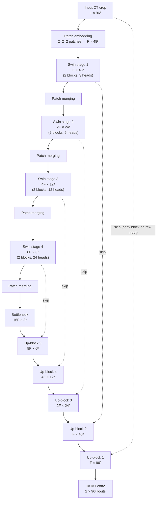

# SwinUNETR architecture, explained

This page explains what the model in [`src/model.py`](../src/model.py) actually
computes, in enough detail that you could sketch it on a whiteboard in an
interview. It assumes you know what a convolution and a U-Net are; the
[glossary](GLOSSARY.md) covers the rest.

- Paper: Hatamizadeh et al., *Swin UNETR: Swin Transformers for Semantic
  Segmentation of Brain Tumors in MRI Images*, 2022 — <https://arxiv.org/abs/2201.01266>
- Implementation used here: [`monai.networks.nets.SwinUNETR`](https://docs.monai.io/en/stable/networks.html#swinunetr)
- Underlying encoder: Liu et al., *Swin Transformer*, 2021 — <https://arxiv.org/abs/2103.14030>

---

## 1. The problem it solves

3D semantic segmentation means giving every voxel of a CT volume a class
(here: background or spleen). Two families of models dominate:

| | 3D CNN (e.g. 3D U-Net) | Transformer encoder (e.g. SwinUNETR) |
|---|---|---|
| How a voxel "sees" context | Through stacked local kernels; the receptive field grows slowly with depth | Self-attention compares every token with every other token in its window; windows shift so information spreads quickly |
| Strengths | Data-efficient, fast, strong local detail | Models long-range relationships (organ shape, position relative to other organs) |
| Weaknesses | Limited global context | Attention is expensive; needs care to scale to 3D |

SwinUNETR keeps the best of both: a **Swin Transformer encoder** for context
and a **convolutional decoder** with skip connections for sharp boundaries.

## 2. Shapes through the network

With the default config (`roi_size = 96³`, `feature_size F = 48`), one input
crop flows like this (channels × D × H × W, batch dimension omitted):



The numbers fall straight out of the design: each of the 5 downsampling steps
(patch embedding + 4 patch merges) halves the spatial size and the merges
double the channels. This is why **`roi_size` must be divisible by 32** —
`src/model.py:validate_roi` checks it.

## 3. The encoder, step by step

### 3.1 Patch embedding
The 96³ volume is cut into non-overlapping 2×2×2 patches; each patch (8
voxels) is linearly projected to an `F`-dimensional vector. That is just a 3D
convolution with kernel size 2 and stride 2. Result: 48³ = 110,592 "tokens".

### 3.2 Why not plain self-attention?
Global self-attention compares every token with every other token: 110,592²
≈ 1.2 × 10¹⁰ pairs per head, far beyond any GPU. Swin's answer is to restrict
attention to **local windows**.

### 3.3 Window attention (W-MSA)
Tokens are grouped into windows of 7×7×7 = 343 tokens and multi-head
self-attention runs *inside each window only*. The cost becomes linear in the
number of tokens. (48 is not a multiple of 7, so MONAI pads the token grid to
49³ before partitioning; you will see harmless "TracerWarning"s about this
padding during ONNX export.)

### 3.4 Shifted window attention (SW-MSA)
With fixed windows, a token at the edge of one window can never see its
neighbour across the border. So every second block **shifts the window grid
by (3, 3, 3) tokens** (half a window) before partitioning. Blocks alternate
W-MSA → SW-MSA, so after two blocks information has crossed window borders;
after several stages (each operating on a coarser grid) every location
effectively has a global receptive field. An attention mask prevents tokens
that were wrapped around by the cyclic shift from attending to each other.

Each Swin block is the standard transformer recipe:

```
x = x + Attention(LayerNorm(x))    # (shifted) window multi-head self-attention
x = x + MLP(LayerNorm(x))          # 2-layer MLP, hidden width 4×
```

### 3.5 Patch merging
Between stages, each 2×2×2 group of neighbouring tokens is concatenated
(8 × C channels) and linearly projected to 2 × C. This is the transformer
equivalent of a strided convolution: half the resolution, double the width.

## 4. The decoder

The decoder is a convolutional U-Net decoder:

1. Each encoder stage's output (and the raw input) first passes through a
   small residual convolution block ("encoder" blocks `encoder1..4` and
   `encoder10` in MONAI's code) to adapt the transformer features for the CNN.
2. Each up-block doubles the resolution with a **transposed convolution**,
   concatenates the matching skip connection, and refines with a residual
   convolution block (3×3×3 convs + instance normalisation + LeakyReLU).
3. A final 1×1×1 convolution maps `F` channels to 2 logits per voxel.

Skip connections are essential: the deep stages know *what* the spleen looks
like, the shallow ones know *exactly where* its boundary is.

## 5. Model size

Counts produced by `python -m src.model` / the unit tests (MONAI 1.6.1):

| `feature_size` | Parameters | Used for |
|---:|---:|---|
| 12 | 4.08 M | local smoke test only |
| 24 | 15.7 M | lighter alternative if the T4 is too slow |
| 48 | 62.2 M | default; the paper's configuration |

Parameters scale roughly with `F²`, because most of them sit in linear layers
whose input and output widths both scale with `F`.

## 6. From logits to a segmentation

The network outputs 2 logits per voxel. During training they go into the
DiceCE loss (softmax inside). At inference time we take `argmax` over the
channel dimension: 0 = background, 1 = spleen. Whole volumes are processed
with sliding-window inference, explained in [TRAINING.md](TRAINING.md#sliding-window-inference).

## 7. Things worth knowing for deployment

- **Fixed shapes help.** Window partitioning reshapes tensors based on the
  input size. With a fixed input shape those reshapes become constants, which
  is what makes clean ONNX export and TensorRT compilation possible (see
  [ONNX_TENSORRT.md](ONNX_TENSORRT.md)).
- **LayerNorm and softmax are precision-sensitive.** Under FP16 they can
  overflow. Exporting with ONNX opset ≥ 17 keeps `LayerNormalization` as a
  single op that TensorRT maps to its dedicated normalization layer, instead
  of a chain of small reduce/divide ops that are more fragile in FP16. Even
  so, compare the TensorRT FP16 Dice with PyTorch FP32 — that is the real test.
- **Memory is dominated by activations at the 48³ stage**, not by weights.
  That is why the training batch is 1 volume × 4 crops, and why
  `model.use_checkpoint` (gradient checkpointing) exists.

## 8. Further reading

- Tang et al., *Self-Supervised Pre-Training of Swin Transformers for 3D
  Medical Image Analysis* (CVPR 2022) — the SwinUNETR pre-training paper:
  <https://arxiv.org/abs/2111.14791>
- MONAI's BTCV SwinUNETR tutorial (multi-organ version of this project):
  <https://github.com/Project-MONAI/tutorials/tree/main/3d_segmentation>
