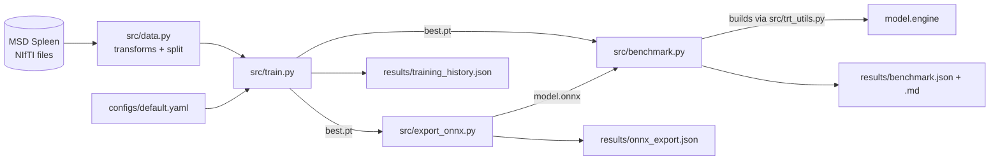

# Code walkthrough

A file-by-file tour, in the order data flows through the project. Every
module also has a detailed docstring at the top, so `python -m src.<name> --help`
and reading the first screen of each file are good companions to this page.

```
swinunetr-spleen-tensorrt/
├── configs/default.yaml          all hyperparameters + the smoke-test overrides
├── src/
│   ├── utils.py                  config loading, device choice, seeding, JSON output
│   ├── data.py                   download, split, MONAI transforms, DataLoaders, synthetic data
│   ├── model.py                  SwinUNETR construction / checkpoint loading
│   ├── evaluation.py             sliding-window inference + Dice (shared by train & benchmark)
│   ├── train.py                  training loop (CLI)
│   ├── export_onnx.py            ONNX export + verification against PyTorch (CLI)
│   ├── trt_utils.py              TensorRT engine build + runner (CUDA only, lazily imported)
│   └── benchmark.py              PyTorch FP32 vs AMP vs TensorRT FP16 (CLI)
├── tests/                        pytest: transforms, splitting, model shapes, TensorRT guard
├── notebooks/colab_train_and_benchmark.ipynb
├── docs/                         you are here
└── results/                      committed JSON/Markdown results (once real numbers exist)
```

Data flow:



---

## `configs/default.yaml`

One YAML file is the single source of truth for hyperparameters. The
`smoke_test:` block at the bottom lists only the values that change for the
tiny local run, so the difference between "real" and "smoke" is visible at a
glance. See [TRAINING.md §3](TRAINING.md#3-every-hyperparameter) for every key.

## `src/utils.py`

- `load_config(path, smoke_test)`: reads the YAML and deep-merges the
  `smoke_test` block when asked (`deep_update` merges nested dicts key by key).
- `resolve_path`: relative paths in the config are resolved against the repo
  root, so scripts work from any working directory.
- `get_device("auto")`: CUDA → MPS → CPU.
- `set_seed`: seeds Python, NumPy, PyTorch and MONAI.
- `environment_info`: versions + GPU name, attached to every result file.

## `src/data.py`

- `download_spleen`: downloads and MD5-checks the MSD tarball using the URL
  and checksum that MONAI ships.
- `load_datalist`: reads `dataset.json` (not a glob, which would pick up macOS
  `._` files in the tarball).
- `split_datalist`: deterministic, order-independent split. Unit-tested.
- `get_train_transforms` / `get_val_transforms`: the MONAI pipelines,
  explained line by line in [DATA.md](DATA.md).
- `make_synthetic_dataset`: fake volumes for tests and `--synthetic` runs.
- `build_dataloaders`: wraps everything in `CacheDataset` + `DataLoader`.
  Validation uses batch size 1 because volumes have different shapes.

## `src/model.py`

- `build_model`: `monai.networks.nets.SwinUNETR` with the configured
  `feature_size`. It validates that the width is divisible by 12.
- `validate_roi`: crop sizes must be divisible by 32.
- `load_checkpoint`: rebuilds the model from the config **stored in the
  checkpoint**, so the right architecture is always used.

## `src/evaluation.py`

- `predict_volume`: thin wrapper around MONAI's `sliding_window_inference`
  with Gaussian blending. It accepts *any* callable that maps a batch of
  windows to logits: a PyTorch model or a `TRTPredictor`.
- `DiceScorer`: argmax → one-hot → `DiceMetric(include_background=False)`.

## `src/train.py`

- `parse_args` / `build_config`: YAML → smoke-test overrides → CLI overrides.
- `train`: the loop. Per epoch: random crops → forward under autocast →
  DiceCE → scaled backward → AdamW step. Cosine LR schedule. Validation
  every `val_interval` epochs. `best.pt` saved on improvement.
- `validate`: sliding-window Dice over whole validation volumes.

## `src/export_onnx.py`

- `export`: `torch.onnx.export` with a fixed `(sw_batch_size, 1, *roi)`
  input, opset 18, TorchScript exporter.
- `verify`: ONNX checker + PyTorch vs ONNX Runtime comparison with
  `atol`/`rtol`. Exits non-zero on failure.

## `src/trt_utils.py`

- `_require_tensorrt`: the guard. It checks CUDA, then imports `tensorrt`.
- `build_engine`: ONNX → TensorRT FP16 engine on disk (TensorRT 10 API).
- `TRTPredictor`: loads an engine, binds pre-allocated PyTorch CUDA buffers by
  tensor name, runs `execute_async_v3` on PyTorch's stream, and pads or
  chunks batches to the engine's fixed batch size.

## `src/benchmark.py`

- Preprocesses all validation volumes onto the device once.
- `run_backend`: warm-up, then synchronised wall-clock timing of
  sliding-window inference per volume, plus Dice.
- Runs `pytorch_fp32`; `pytorch_amp` and `tensorrt_fp16` only on CUDA
  (otherwise recorded as skipped). TensorRT is imported only inside the CUDA
  branch.
- `to_markdown`: the README table.

## `tests/`

| Test | What it protects |
|---|---|
| `test_split_*` | Split is deterministic, disjoint, 33/8, respects `max_volumes`, rejects 1 volume |
| `test_train_transforms_output` | Crops have the right count and shape; intensities in range; labels stay binary |
| `test_val_transforms_keep_label_aligned` | Image and label shapes match; cropping keeps the spleen |
| `test_output_shape_matches_input` | Model output is `(B, 2, *roi)` for cubic and non-cubic crops |
| `test_sliding_window_handles_arbitrary_volume_size` | Odd-sized volumes, smaller than a window, work |
| `test_invalid_sizes_are_rejected` | Bad `roi_size` / `feature_size` fail with a clear error |
| `test_default_model_size` | Default model has ~62M parameters (catches accidental config changes) |
| `test_tensorrt_module_imports_without_cuda` | The TensorRT guard works on CUDA-less machines |

Run them with `pytest -q`.

## `.github/workflows/tests.yml`

GitHub Actions runs `pytest` and the synthetic smoke pipeline (train →
export → benchmark) on a CPU runner for every push, so the badge in the README
shows whether the code currently works.
