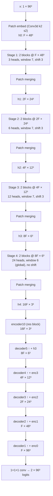

# Architecture: SwinUNETR as instantiated here

Code: [`src/model.py`](../../src/model.py), wrapping
`monai.networks.nets.SwinUNETR` (MONAI 1.6.1, `use_v2=False`).

- Hatamizadeh et al., *Swin UNETR*, BrainLes 2021, arXiv:2201.01266
- Liu et al., *Swin Transformer*, ICCV 2021, arXiv:2103.14030
- Tang et al., *Self-supervised pre-training of Swin Transformers for 3D medical image analysis*, CVPR 2022, arXiv:2111.14791 (not used here: weights are trained from scratch)

---

## 1. Configuration

| Argument | Value | Note |
|---|---|---|
| `in_channels` / `out_channels` | 1 / 2 | Two-class softmax head |
| `feature_size` $F$ | 48 (smoke: 12) | Must be divisible by 12 (`build_model` checks) |
| `patch_size` | 2 | |
| `depths` | (2, 2, 2, 2) | One W-MSA + one SW-MSA block per stage |
| `num_heads` | (3, 6, 12, 24) | Head dim is constant at $F/3 = 16$ |
| `window_size` | 7 | Shift $\lfloor 7/2 \rfloor = 3$ |
| `mlp_ratio` | 4 | |
| `qkv_bias` | True | |
| `norm_name` (decoder) | instance | |
| `normalize` | True | LayerNorm on each hidden state before it leaves the encoder |
| `patch_norm` | False | |
| `dropout_path_rate` | 0.0 | No stochastic depth |
| `use_checkpoint` | False | Activation checkpointing switch |

## 2. Shapes (input $1 \times 96^3$, $F = 48$)



Encoder-side adapters (residual conv blocks): `enc0 = encoder1(x)` at
$F \times 96^3$, `enc1 = encoder2(h0)`, `enc2 = encoder3(h1)`,
`enc3 = encoder4(h2)`. `h3` enters `decoder5` directly as a skip. Here `hk`
is the k-th element of MONAI's `hidden_states_out` (each stage's
post-merging output, LayerNorm-ed because `normalize=True`).

Five 2× reductions (embed + 4 merges) mean every spatial dimension must be
divisible by 32. `validate_roi` enforces this. MONAI only checks it outside
tracing.

## 3. Encoder details

**Patch embedding.** `Conv3d(1, F, kernel=2, stride=2)`: 48³ = 110,592 tokens
of width $F$. No positional embedding is added. Position enters only through
the relative position bias.

**Window attention.** Tokens are partitioned into non-overlapping $M^3$
windows ($M = 7$, 343 tokens). Per window and head:

```math
\mathrm{Attn}(Q,K,V) = \mathrm{softmax}\!\left(\frac{QK^\top}{\sqrt{d}} + B\right) V,
\qquad d = F/3 = 16,
```

with $B \in \mathbb{R}^{M^3 \times M^3}$ indexed from a learned table of size
$(2M-1)^3 \times n_\text{heads}$ by relative offset. Cost per block is
$\mathcal{O}(N M^3 C)$ rather than $\mathcal{O}(N^2 C)$. Global attention at
stage 1 would need $N^2 \approx 1.2 \times 10^{10}$ scores per head.

**Padding.** Grids that are not multiples of $M$ are zero-padded before
partitioning: 48 → 49, 24 → 28, 12 → 14. These are the data-dependent
`if pad > 0` branches that the tracer warns about at export. With fixed shapes
they resolve to constants.

**Shifted windows.** The second block of each stage cyclically rolls the grid
by $(-3,-3,-3)$ before partitioning and masks attention between tokens that
were not spatially adjacent before the roll. W-MSA/SW-MSA alternation gives
cross-window connectivity at the cost of one roll per block.

**Small grids.** MONAI's `get_window_size` clamps the window to the grid and
sets shift to 0 when the grid side is ≤ $M$. At stage 4 (6³), every block
therefore runs **global attention over 216 tokens, without shifting**.

**Block.** Pre-norm transformer: $x \leftarrow x + \mathrm{(S)W\text{-}MSA}(\mathrm{LN}(x))$,
$x \leftarrow x + \mathrm{MLP}(\mathrm{LN}(x))$, MLP $C \to 4C \to C$ with GELU.

**Patch merging** (v1). Concatenate the 8 tokens of each $2^3$ neighbourhood
($8C$), LayerNorm, linear $8C \to 2C$.

## 4. Decoder

`UnetrUpBlock`: transposed conv (k2, s2) for 2× upsampling, concatenation with
the skip, then a residual block of two 3³ convs with InstanceNorm and
LeakyReLU. `encoder*` adapters are the same residual block without
upsampling. The head is a 1³ conv, $F \to 2$.

The CNN decoder and the full-resolution skip (`encoder1` on the raw input)
give voxel-accurate boundaries that a token grid at 2 mm × 2 (3–4 mm
effective) cannot.

## 5. Size

Measured with `count_parameters` (MONAI 1.6.1, trainable parameters):

| $F$ | Parameters | Use |
|---:|---:|---|
| 12 | 4.08 M | CPU smoke test |
| 24 | 15.7 M | Fallback if T4 memory or time is short |
| 48 | 62.2 M | Default, paper configuration |

Scaling is ≈ $F^2$ (linear and conv weights dominate). The unit test
`test_default_model_size` asserts 55–70 M for $F = 48$, which guards against
silent config drift.

Training memory is dominated by stage-1 activations ($F \times 48^3$
tokens, with $\mathcal{O}(M^3)$ attention maps per window) and full-resolution
decoder activations, not by weights. This is why the per-step batch is 4
crops from 1 case, and why `use_checkpoint` is exposed.

## 6. Deployment-relevant properties

- **Fixed shape.** Window partitioning, padding and masks are computed from
  the input shape. Exporting at exactly $(4, 1, 96, 96, 96)$ folds them into
  constants (see [deployment.md](deployment.md)).
- **FP16-sensitive ops.** LayerNorm (every block, merging, hidden-state
  normalisation) and softmax over 343-element rows with an additive bias.
  Opset ≥ 17 exports LayerNorm as a single `LayerNormalization` node, which
  TensorRT maps to a normalisation layer it can run with FP32 accumulation.
  The benchmark reports Dice per backend, so any FP16 degradation shows up
  as a measurement and is not assumed away.
- **No data-dependent control flow** beyond the shape checks, so the graph is
  static once the shape is fixed.
