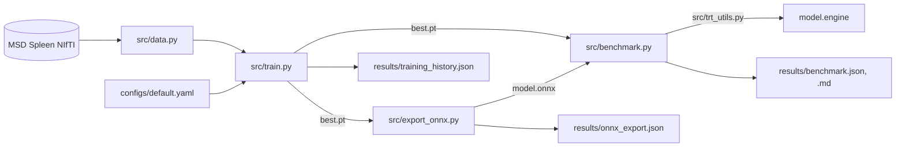

# Code map and reproducibility

Each module has a docstring describing its contract, and every CLI supports
`--help`.

```
configs/default.yaml        single source of hyperparameters + smoke-test overrides
src/utils.py                config merge, path resolution, device selection, seeding, provenance
src/data.py                 download/verify, split, MONAI pipelines, DataLoaders, synthetic fixtures
src/model.py                SwinUNETR construction, shape/width validation, checkpoint loading
src/evaluation.py           sliding-window inference + Dice (shared by train and benchmark)
src/train.py                training CLI
src/export_onnx.py          ONNX export + ONNX Runtime parity check (CLI)
src/trt_utils.py            TensorRT build + runtime wrapper (CUDA-guarded, lazily imported)
src/benchmark.py            FP32 / AMP / TensorRT FP16 latency and Dice (CLI)
tests/                      pytest (synthetic data only)
notebooks/                  Colab T4 end-to-end run
.github/workflows/tests.yml CPU CI: unit tests + synthetic train → export → benchmark
```



## Design decisions

| Decision | Where | Why |
|---|---|---|
| One YAML, deep-merged smoke overrides, CLI on top | `utils.load_config`, `train.build_config` | The smoke/full difference is visible in one place. No duplicated configs |
| Config embedded in checkpoints and results | `train.py`, `benchmark.py`, `export_onnx.py` | Any number traces back to exact settings. Downstream stages rebuild the model from the checkpoint's config, not the current YAML |
| Paths resolved against the repo root | `utils.resolve_path` | CLIs work from any working directory |
| Single `predict_volume` for validation and benchmark | `evaluation.py` | Training-time Dice and benchmark Dice use the same code path |
| Backends as callables | `TRTPredictor.__call__` | TensorRT drops into MONAI's inferer without special cases |
| Lazy, guarded TensorRT import | `trt_utils._require_tensorrt` | Repo installs and tests on macOS and CPU CI |
| Skipped ≠ estimated | `benchmark.py` | Missing hardware yields an explicit `skipped` record |
| Artifacts git-ignored | `.gitignore` | No data (license), weights, ONNX or engines in git. `results/smoke/` excluded too |

## Provenance

`environment_info()` records Python, platform, torch, MONAI, CUDA, cuDNN and
GPU name, and the benchmark adds the TensorRT version. Together with the
embedded config, every JSON in `results/` is self-describing.

## Determinism

Seeded: Python `random`, NumPy, torch, MONAI (`set_determinism`), and the
split (independent of filesystem order). Not enforced: deterministic CUDA
kernels. See [training.md §8](training.md#8-determinism).

## Dependencies

- `requirements.txt`: fully pinned local environment (Python 3.12, macOS arm64
  verified, CPU/MPS torch 2.15.0).
- `requirements-colab.txt`: pinned extras only. It keeps Colab's CUDA torch.
  The notebook then installs `tensorrt-cu12` or `tensorrt-cu13` `==10.16.1.11`,
  matching `torch.version.cuda`; the 10.x API is what `trt_utils.py` targets.

## Tests

| Test | Guards |
|---|---|
| `test_split_is_deterministic_and_disjoint` | 33/8, order-independent, disjoint |
| `test_split_respects_max_volumes`, `test_split_rejects_single_volume` | Edge cases |
| `test_train_transforms_output` | Crop count/shape, intensity range, binary labels |
| `test_val_transforms_keep_label_aligned` | Image/label alignment, foreground crop keeps spleen |
| `test_output_shape_matches_input` | $(B, 2, *roi)$ for cubic and anisotropic crops |
| `test_sliding_window_handles_arbitrary_volume_size` | Non-multiple-of-32 volumes smaller than the ROI in one axis |
| `test_invalid_sizes_are_rejected` | `roi_size` % 32, `feature_size` % 12 |
| `test_default_model_size` | 55–70 M parameters at $F = 48$ |
| `test_tensorrt_module_imports_without_cuda` | Guard behaviour on CUDA-less hosts |
| `test_resume_continues_from_the_saved_epoch` | Interrupted + `--resume` run keeps pre-interruption losses, full epoch list, continued LR schedule |
| `test_resume_refuses_a_different_config` | A changed `train.epochs` is rejected with the differing key named |
| `test_resume_without_checkpoint_explains_itself`, `test_paths_and_memory_settings_may_change_on_resume` | Missing `last.pt` message; exempt keys (paths, workers, cache, `use_checkpoint`) |

CI (GitHub Actions, `ubuntu-latest`, CPU torch wheel) runs the tests and the
synthetic train → export → benchmark chain on every push and PR. It
verifies that the code executes and says nothing about model quality.

## Extending

- **New backend:** produce a callable `(n, 1, *roi) → (n, 2, *roi)` and call
  `run_backend` with it.
- **New dataset (MSD layout):** set `data.task`. Revisit `hu_window`,
  `pixdim` and `out_channels`.
- **Native-space Dice:** add `Invertd` to the validation path in
  `evaluation.py`/`benchmark.py`, keeping it shared.
